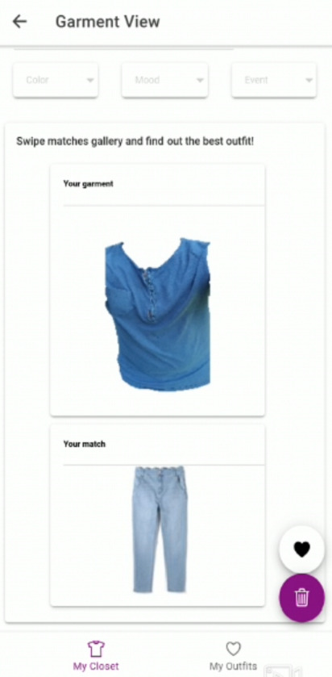
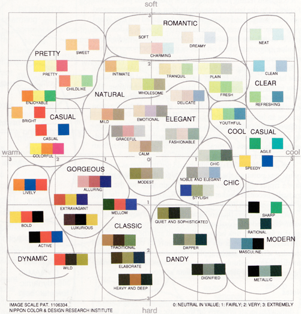

## GARMION
GarmIon is a **cross-platform app**, developed with **Ionic** (**Angular**, **Capacitor**) and a **Flask** python backend, that lets the user build a digital wardrobe by taking pictures of their clothes and leveraging neural networks to get outfit suggestions.

The project was developed as Computer Science Bachelor Thesis for University of Florence UNIFI, Multimedia Design & Production course.

### Main features

1. Photo Capture: Take a picture of a garment with the camera, on mobile or in the browser
2. Segmentation: The backend (**Flask**, **TensorFlow** UNET and **OpenCV**'s GrabCut) segments garment from the rest
3. Smart Recommendations: **Style-Based Outfit Recommendation** model; a Memory Augmented Neural Network "MANN" (similar to RAG)
4. Outfit Creation: Combine garments into outfits and tag them by event and mood (**Fashion2Events** models)

### User Interface

### Color Theory by Kobayashi:
The project incorporates the color theory by **Shigenobu Kobayashi**, a Japanese scholar, to categorize color combinations based on the emotions they convey. This categorization is used to recommend suitable outfit combinations aligned with the user's mood and the event they plan to attend. Kobayashi's color theory associates particular emotions with specific color combinations, creating a system that correlates a particular emotion with a combination of colors. These color combinations, known as Kobayashi triplets, are used to suggest correct outfit pairings for various occasions.

### Kobayashi Triplets
 

    

  
 
